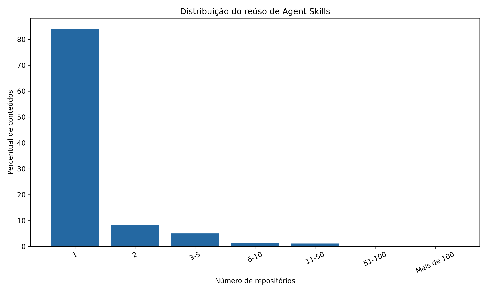
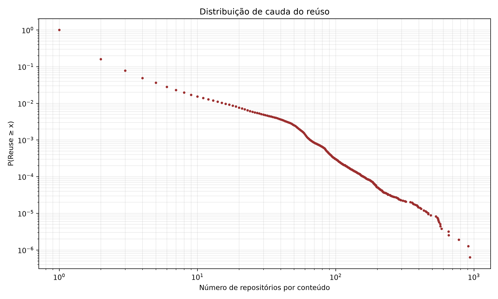
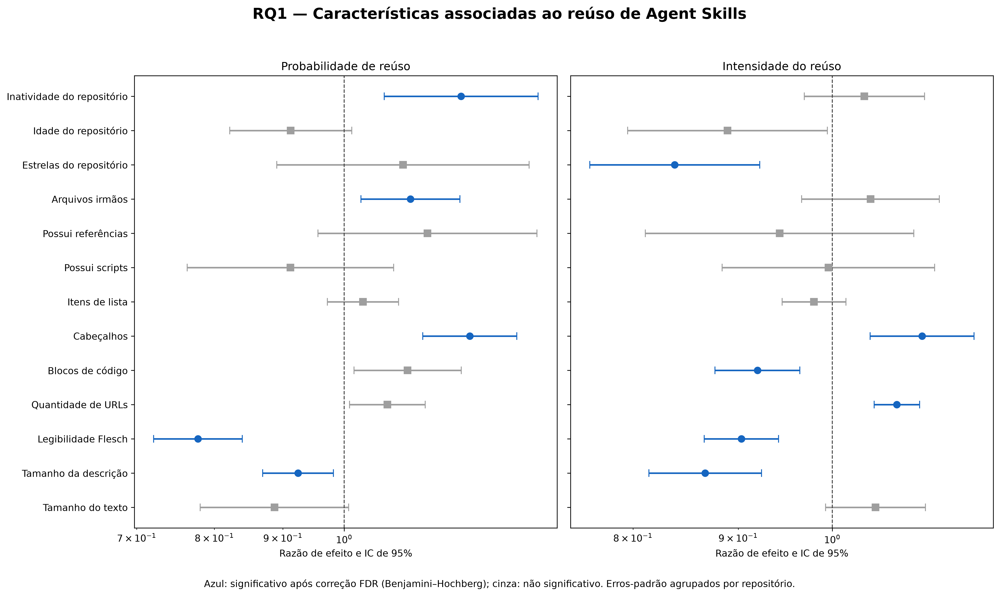

# Resultados da RQ1 — Reutilização de Agent Skills no GitHub

## 1. Questão de pesquisa

**RQ1: Como a reutilização de Agent Skills está distribuída e quais características textuais, estruturais e contextuais estão associadas à sua propagação?**

Esta análise considera como unidade principal cada conteúdo distinto de um arquivo `SKILL.md`, identificado pelo seu hash SHA. O reúso foi definido como a presença de um mesmo conteúdo em repositórios distintos.

## 2. População analisada

A população principal foi definida mediante os seguintes critérios:

- registro marcado como representante da deduplicação (`dedup_primary = 1`);
- nome exato do arquivo igual a `SKILL.md`;
- conteúdo recuperado;
- hash do conteúdo validado;
- frontmatter válido.

Após esses filtros, foram obtidos:

- **1.586.188 conteúdos distintos de `SKILL.md`;**
- **1.584.628 registros no modelo estatístico;**
- **1.560 registros removidos por dados ausentes**, correspondendo a aproximadamente 0,10% da população;
- **218.408 repositórios representantes distintos** no modelo final.

O reúso foi calculado por meio da quantidade de repositórios distintos contendo cada hash:

```text
reuse_count = número de repositórios distintos com o mesmo file_sha
```

Foram derivadas duas variáveis de resposta:

```text
is_reused = 1 quando reuse_count > 1
extra_reuse = reuse_count - 1
```

A primeira representa a ocorrência de reúso. A segunda representa a intensidade adicional de propagação.

## 3. Distribuição do reúso

A análise considerou 1.586.188 conteúdos distintos de arquivos `SKILL.md`. Desse total:

- **1.332.110 (83,98%)** apareceram em somente um repositório;
- **254.078 (16,02%)** foram reutilizados em dois ou mais repositórios;
- a mediana foi de **1 repositório por conteúdo**;
- a média foi de **1,73 repositório por conteúdo**;
- o máximo observado foi de **937 repositórios**;
- o coeficiente de Gini foi de **0,398**.

A distribuição dos conteúdos por faixa de quantidade de repositórios foi a seguinte:

| Repositórios distintos | Conteúdos | Percentual |
|---:|---:|---:|
| 1 | 1.332.110 | 83,9818% |
| 2 | 130.297 | 8,2145% |
| 3–5 | 79.500 | 5,0120% |
| 6–10 | 22.187 | 1,3988% |
| 11–50 | 18.281 | 1,1525% |
| 51–100 | 3.347 | 0,2110% |
| Mais de 100 | 466 | 0,0294% |

A Figura 1 apresenta visualmente essa distribuição. Observa-se uma concentração expressiva na primeira faixa: a maior parte dos conteúdos aparece em apenas um repositório, enquanto as faixas de maior reutilização reúnem parcelas progressivamente menores da população.



*Figura 1 — Distribuição dos conteúdos de Agent Skills por faixa de quantidade de repositórios distintos.*

Os percentis reforçam a elevada concentração da distribuição:

- P50: 1 repositório;
- P75: 1 repositório;
- P90: 2 repositórios;
- P95: 3 repositórios;
- P99: 15 repositórios;
- P99,5: 29 repositórios;
- P99,9: 65 repositórios.

Esses valores demonstram que pelo menos 75% dos conteúdos estão presentes em somente um repositório. Mesmo no percentil 95, um conteúdo aparece em, no máximo, três repositórios. A propagação em dezenas ou centenas de repositórios está, portanto, concentrada em uma parcela muito pequena da população.

Embora somente 16,02% dos conteúdos tenham sido reutilizados, as colocações adicionais decorrentes do reúso representaram **42,06% das colocações em repositórios**. Assim, o reúso é minoritário quando se considera a quantidade de conteúdos distintos, mas possui impacto substancial na composição total dos repositórios.

A Figura 2 apresenta a distribuição complementar acumulada — *Complementary Cumulative Distribution Function* (CCDF) — em escala log-log. Essa representação permite observar com maior clareza os conteúdos de propagação elevada, que seriam pouco visíveis em uma escala linear. O comportamento observado confirma a existência de uma cauda longa: a probabilidade de encontrar conteúdos diminui à medida que a quantidade de repositórios aumenta, mas permanece um subconjunto pequeno que alcança níveis excepcionalmente elevados de propagação.



*Figura 2 — Distribuição complementar acumulada do reúso de Agent Skills em escala log-log, evidenciando a cauda longa da propagação.*

Entre os conteúdos com maior propagação estavam:

| Nome | Repositórios distintos | Ocorrências |
|---|---:|---:|
| frontend-design | 937 | 1.231 |
| verification-before-completion | 912 | 1.248 |
| webapp-testing | 777 | 1.172 |
| pdf | 658 | 1.406 |
| systematic-debugging | 655 | 884 |

A diferença entre o número de ocorrências e a quantidade de repositórios distintos indica que um mesmo conteúdo também pode aparecer mais de uma vez dentro de determinado repositório. Por essa razão, a quantidade de repositórios distintos foi adotada como medida principal de propagação.

Em conjunto, os resultados caracterizam uma distribuição fortemente assimétrica e de cauda longa. A maioria dos conteúdos permanece restrita a um único repositório, enquanto uma parcela reduzida alcança dezenas ou centenas de repositórios e responde por uma quantidade substancial das colocações observadas no ecossistema.

## 4. Métricas explicativas

Foram extraídas características pertencentes a três dimensões.

### 4.1 Características textuais

- tamanho do texto;
- tamanho da descrição;
- legibilidade Flesch;
- quantidade de URLs;
- quantidade de blocos de código;
- quantidade de cabeçalhos;
- quantidade de itens de lista.

### 4.2 Características estruturais

- presença de scripts;
- presença de referências;
- quantidade de arquivos irmãos;
- classe de localização do arquivo;
- indicação de composição truncada.

### 4.3 Características contextuais

- linguagem principal do repositório;
- estrelas do repositório;
- idade do repositório;
- tempo de inatividade do repositório.

As variáveis numéricas assimétricas foram transformadas com `log1p`, winsorizadas nos percentis 0,5 e 99,5 e padronizadas. Portanto, para essas variáveis, as razões de efeito representam a alteração associada ao aumento de um desvio-padrão na variável transformada.

A variável `repo_is_fork` não foi incluída, pois apenas quatro registros do conjunto modelado estavam identificados como forks, impossibilitando uma estimação confiável.

## 5. Estratégia estatística

A análise foi estruturada em duas partes:

1. **Regressão logística:** estima a probabilidade de um conteúdo ser reutilizado.
2. **Modelo condicional de intensidade:** estima a quantidade média de reutilizações adicionais entre os conteúdos que já foram reutilizados.

Inicialmente, conforme o plano de pesquisa, tentou-se utilizar uma regressão binomial negativa truncada em zero na segunda parte. Entretanto, a estimação apresentou solução degenerada em duas implementações independentes:

- `statsmodels`, em Python;
- `pscl::hurdle`, em R.

No R, o parâmetro de dispersão convergiu para aproximadamente zero:

```text
theta ≈ 2,10 × 10⁻⁹
Log(theta) = -19,98
erro-padrão de Log(theta) = 561,10
```

Apesar da indicação formal de convergência, o parâmetro estava no limite do espaço paramétrico e seu erro-padrão era extremamente elevado. Portanto, os coeficientes da binomial negativa truncada não foram considerados interpretáveis.

Como alternativa, foi adotado um modelo de **Poisson de pseudomáxima verossimilhança (PPML)** para a média condicional de `extra_reuse` entre os registros positivos. A inferência utilizou erros-padrão robustos agrupados por repositório representante.

O PPML não exige que a variância seja igual à média quando utilizado com covariância robusta. Essa característica foi necessária porque a parte positiva apresentou:

- média de `extra_reuse`: **4,53**;
- variância: **154,30**;
- dispersão de Pearson: **16,47**.

Os erros-padrão agrupados foram utilizados como inferência principal porque os conteúdos pertencentes ao mesmo repositório não podem ser considerados independentes. Em comparação com erros HC1 convencionais, os erros-padrão agrupados foram, na mediana, **10,95 vezes maiores**.

Por fim, os valores de significância foram corrigidos separadamente em cada componente pelo método de Benjamini–Hochberg, controlando a taxa de falsos achados em 5%.

## 6. Características associadas à probabilidade de reúso

Após o agrupamento por repositório e a correção de Benjamini–Hochberg, cinco características principais apresentaram associação estatisticamente significativa com a probabilidade de reúso.

| Característica | Odds ratio | IC de 95% | q-value | Interpretação |
|---|---:|---:|---:|---|
| Tamanho da descrição | 0,924 | 0,869–0,982 | 0,0482 | Associação negativa de aproximadamente 7,6% |
| Legibilidade Flesch | 0,778 | 0,721–0,839 | < 0,0001 | Associação negativa de aproximadamente 22,2% |
| Quantidade de cabeçalhos | 1,241 | 1,145–1,345 | < 0,0001 | Associação positiva de aproximadamente 24,1% |
| Quantidade de arquivos irmãos | 1,121 | 1,029–1,220 | 0,0458 | Associação positiva de aproximadamente 12,1% |
| Inatividade do repositório | 1,223 | 1,071–1,395 | 0,0211 | Associação positiva de aproximadamente 22,3% |

Não permaneceram significativos após a correção FDR: tamanho total do texto, quantidade de URLs, quantidade de blocos de código, quantidade de itens de lista, presença de scripts, presença de referências, estrelas do repositório, idade do repositório e composição truncada.

Os resultados indicam que conteúdos mais estruturados por cabeçalhos e inseridos em diretórios com maior quantidade de arquivos relacionados apresentaram maior probabilidade de reaparecer em outros repositórios.

A associação negativa da legibilidade Flesch deve ser interpretada com cautela, pois a métrica foi originalmente desenvolvida para textos em inglês e o corpus possui conteúdo multilíngue.

## 7. Características associadas à intensidade do reúso

Entre os conteúdos que já foram reutilizados, seis características principais permaneceram significativas após a correção FDR.

| Característica | Razão de média condicional | IC de 95% | q-value | Interpretação |
|---|---:|---:|---:|---|
| Tamanho da descrição | 0,867 | 0,814–0,924 | 0,0001 | Intensidade aproximadamente 13,3% menor |
| Legibilidade Flesch | 0,903 | 0,866–0,942 | < 0,0001 | Intensidade aproximadamente 9,7% menor |
| Quantidade de URLs | 1,075 | 1,048–1,103 | < 0,0001 | Intensidade aproximadamente 7,5% maior |
| Quantidade de blocos de código | 0,920 | 0,877–0,964 | 0,0023 | Intensidade aproximadamente 8,0% menor |
| Quantidade de cabeçalhos | 1,106 | 1,043–1,172 | 0,0026 | Intensidade aproximadamente 10,6% maior |
| Estrelas do repositório | 0,838 | 0,762–0,922 | 0,0013 | Intensidade aproximadamente 16,2% menor |

Não permaneceram significativos após a correção FDR: tamanho total do texto, quantidade de itens de lista, presença de scripts, presença de referências, quantidade de arquivos irmãos, idade do repositório, inatividade do repositório e composição truncada.

Os efeitos devem ser interpretados como associações condicionais, mantidas as demais características constantes. Eles não representam relações causais.

## 8. Testes de sensibilidade

### 8.1 Megarepositórios

A distribuição da quantidade de conteúdos por repositório foi muito desigual:

- mediana: 2 conteúdos;
- percentil 99: 61 conteúdos;
- percentil 99,9: aproximadamente 368 conteúdos;
- máximo: 27.006 conteúdos.

Os 16 repositórios com mais de 5.000 conteúdos concentravam 183.623 registros, equivalentes a 11,59% da população modelada.

O modelo foi reestimado após a remoção desses 16 megarepositórios. As 28 associações referentes às 14 características principais, consideradas nos dois componentes, mantiveram a mesma direção.

Alguns efeitos limítrofes alteraram sua classificação de significância, mas os padrões centrais permaneceram. As maiores instabilidades gerais ocorreram nas categorias de linguagem de programação, indicando que essas categorias são particularmente sensíveis à presença de grandes catálogos e repositórios agregadores.

### 8.2 Cauda extrema do reúso

Entre os registros positivos:

- mediana de `extra_reuse`: 1;
- P95: 18;
- P99: 57;
- P99,5: 70;
- P99,9: 127;
- máximo: 936.

Foi realizada uma análise winsorizando no valor 70 os 1.267 registros acima do percentil 99,5.

Resultados:

- os 37 coeficientes da parte de intensidade mantiveram a mesma direção;
- os 37 mantiveram a mesma classificação de significância;
- a diferença absoluta média entre os coeficientes foi de 0,0308;
- a dispersão de Pearson diminuiu de 16,47 para 9,23.

Portanto, os resultados da intensidade não foram determinados exclusivamente pelos casos de propagação extrema.

### 8.3 Amostra de teste e população completa

Na comparação entre a amostra de 100.000 registros e a população completa:

- 71 dos 74 coeficientes mantiveram a mesma direção;
- a diferença absoluta média foi de 0,0684;
- as principais instabilidades ocorreram nas categorias de linguagem.

Esses resultados justificam a utilização da população completa como análise principal.

## 9. Resposta à RQ1

A reutilização de Agent Skills apresenta uma distribuição fortemente assimétrica e de cauda longa. Aproximadamente 84% dos conteúdos distintos aparecem em somente um repositório, enquanto 16,02% são reutilizados. Contudo, as colocações adicionais provenientes do reúso representam 42,06% das colocações em repositórios, demonstrando que uma parcela relativamente pequena dos conteúdos possui impacto expressivo na composição do ecossistema.

As características mais consistentemente associadas à propagação foram:

- maior organização por cabeçalhos;
- presença de maior quantidade de arquivos relacionados no mesmo diretório;
- presença de URLs;
- extensão da descrição;
- legibilidade textual;
- quantidade de blocos de código;
- atividade e popularidade do repositório.

Entretanto, uma característica pode estar associada de maneira diferente ao início e à intensidade do reúso. Por exemplo, a quantidade de arquivos irmãos esteve associada à probabilidade de um conteúdo ser reutilizado, mas não à intensidade posterior da propagação. Da mesma forma, as estrelas do repositório não apresentaram associação robusta com a ocorrência inicial do reúso, mas estiveram negativamente associadas à intensidade entre conteúdos já reutilizados.

Em síntese, a propagação não está associada apenas ao tamanho do conteúdo. Ela se relaciona principalmente com a forma de organização textual, com determinados elementos de documentação e com o contexto do repositório. Esses resultados permaneceram amplamente consistentes após o agrupamento por repositório, a remoção dos maiores agregadores e o controle da cauda extrema.

## 10. Limitações

1. A análise é observacional e transversal; portanto, não permite inferir causalidade.
2. O reúso exato foi identificado por hash e não inclui cópias modificadas ou variantes semanticamente equivalentes.
3. O repositório representante é uma ocorrência definida pelo processo de deduplicação e não necessariamente corresponde ao repositório de origem do conteúdo.
4. As características contextuais referem-se ao repositório representante.
5. O histórico de commits estava disponível para somente aproximadamente 24,64% da população e não foi incluído no modelo principal da RQ1.
6. A legibilidade Flesch é orientada ao inglês e possui validade limitada em um corpus multilíngue.
7. Grandes catálogos e repositórios agregadores concentram quantidade expressiva de conteúdos.
8. A classificação de linguagem apresentou maior sensibilidade à presença dos megarepositórios.
9. A binomial negativa truncada planejada apresentou solução degenerada e precisou ser substituída por PPML condicional com covariância robusta.
10. Os resultados representam associações entre características disponíveis no dataset e reúso observado, não necessariamente mecanismos de adoção.

## 11. Arquivos produzidos

### Dados e estatísticas descritivas

- `outputs/rq1/reuse_by_content.csv`
- `outputs/rq1/descriptive_summary.csv`
- `outputs/rq1/descriptive_summary.json`
- `outputs/rq1/reuse_ranges.csv`
- `outputs/rq1/reuse_percentiles.csv`
- `outputs/rq1/reuse_concentration.csv`
- `outputs/rq1/top_100_reused_detailed.csv`
- `outputs/rq1/rq1_features.parquet`
- `outputs/rq1/rq1_model_data_with_repo.parquet`

### Modelos

- `outputs/rq1/models_full/two_part_robust/`
- `outputs/rq1/models_full/two_part_clustered/`
- `outputs/rq1/sensitivity/no_mega_repos/`
- `outputs/rq1/sensitivity/tail_p99_5/`

### Resultados finais

- `outputs/rq1/final/rq1_main_effects.csv`
- `outputs/rq1/final/rq1_contextual_effects.csv`
- `outputs/rq1/final/rq1_sensitivity_comparison.csv`
- `outputs/rq1/final/rq1_effects_forest_plot.png`


