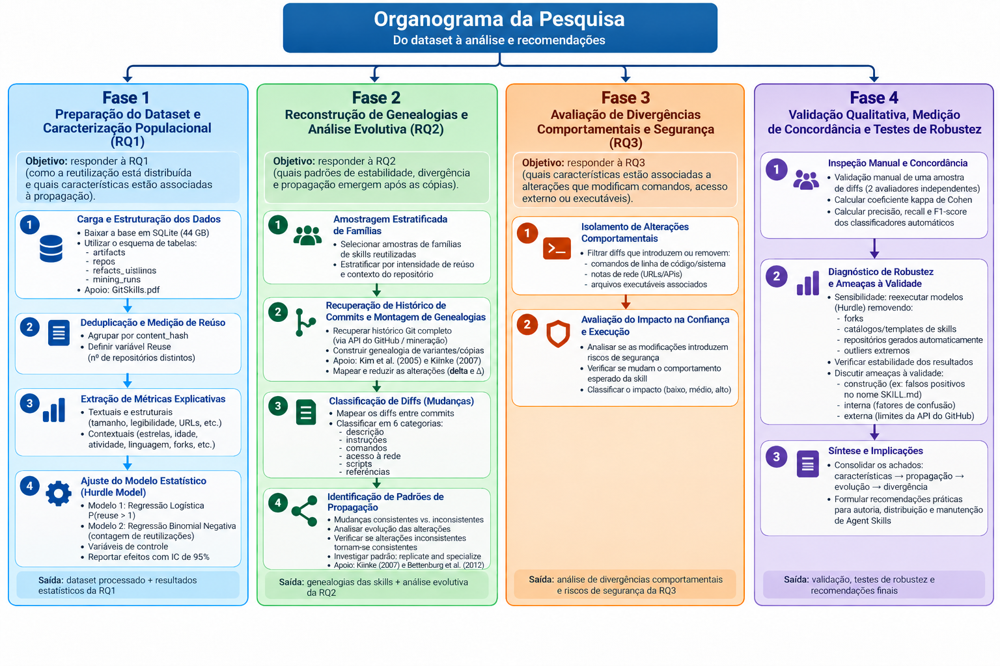
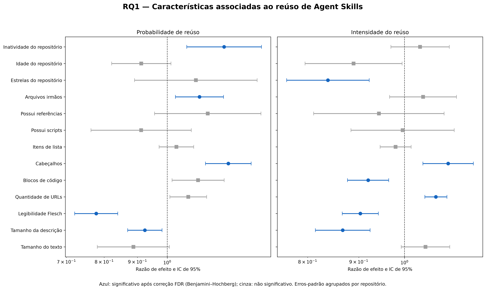

# Da cópia à divergência: reutilização de Agent Skills no GitHub

Este repositório reúne os scripts, resultados e a documentação de um estudo empírico sobre a reutilização, a propagação e a evolução de **Agent Skills** em repositórios públicos do GitHub.

O trabalho foi desenvolvido no contexto da disciplina **Tópicos em Engenharia de Sistemas de Software II** e utiliza o dataset GitSkills. A análise disponível atualmente concentra-se na primeira questão de pesquisa (RQ1), dedicada a entender como conteúdos de arquivos `SKILL.md` são reutilizados e quais características estão associadas à sua propagação.

> **Pesquisador:** Jemison dos Santos
>
> **Snapshot dos dados:** julho de 2026
>
> **Estado atual:** RQ1 concluída; RQ2, RQ3 e validação qualitativa planejadas

## Visão geral da pesquisa



O projeto foi organizado em quatro fases:

1. **Preparação e caracterização populacional (RQ1):** distribuição do reúso e características associadas à propagação;
2. **Reconstrução de genealogias (RQ2):** estabilidade, divergência e evolução após a cópia;
3. **Divergências comportamentais e segurança (RQ3):** alterações em comandos, acessos externos e executáveis;
4. **Validação e robustez:** inspeção manual, concordância entre avaliadores e testes de sensibilidade.

O conteúdo deste repositório documenta principalmente a **Fase 1**.

## Questão de pesquisa

> **RQ1:** Como a reutilização de Agent Skills está distribuída e quais características textuais, estruturais e contextuais estão associadas à sua propagação?

A unidade de análise é cada conteúdo distinto de um arquivo `SKILL.md`, identificado por seu hash SHA. O reúso é medido pela quantidade de repositórios distintos nos quais o mesmo conteúdo aparece:

```text
reuse_count = número de repositórios distintos contendo o mesmo file_sha
```

São consideradas duas respostas complementares:

- `is_reused`: indica se o conteúdo aparece em mais de um repositório;
- `extra_reuse`: número de repositórios adicionais após a primeira ocorrência.

## Principais resultados

A população analisada contém **1.586.188 conteúdos distintos** de arquivos `SKILL.md`, distribuídos em centenas de milhares de repositórios.

| Indicador | Resultado |
|---|---:|
| Conteúdos distintos | 1.586.188 |
| Conteúdos presentes em um único repositório | 1.332.110 (83,98%) |
| Conteúdos reutilizados | 254.078 (16,02%) |
| Mediana de repositórios por conteúdo | 1 |
| Máximo de repositórios para um conteúdo | 937 |
| Coeficiente de Gini | 0,398 |
| Participação do reúso nas colocações em repositórios | 42,06% |

Os resultados mostram uma distribuição fortemente assimétrica e de cauda longa: a maior parte dos conteúdos permanece em um único repositório, enquanto uma pequena parcela alcança dezenas ou centenas de repositórios.

Entre as características mais consistentemente associadas à propagação estão a organização por cabeçalhos, a quantidade de arquivos relacionados, a presença de URLs, a extensão da descrição, a legibilidade textual, a quantidade de blocos de código e características do repositório.

Esses resultados representam **associações**, não relações causais.



## Estratégia de análise

As variáveis explicativas foram agrupadas em três dimensões:

- **Textuais:** tamanho, descrição, legibilidade, URLs, blocos de código, cabeçalhos e listas;
- **Estruturais:** presença de scripts e referências, arquivos irmãos, localização e composição truncada;
- **Contextuais:** linguagem principal, estrelas, idade e inatividade do repositório.

A modelagem final possui duas partes:

1. regressão logística para estimar a probabilidade de um conteúdo ser reutilizado;
2. Poisson de pseudomáxima verossimilhança (PPML) para estimar a intensidade entre conteúdos já reutilizados.

A inferência utiliza erros-padrão robustos agrupados pelo repositório representante e correção de Benjamini–Hochberg para múltiplos testes.

O plano inicial, ainda representado no organograma, previa uma binomial negativa truncada na segunda parte do modelo. Essa estimação apresentou uma solução degenerada em implementações independentes em Python e R. Por esse motivo, ela foi substituída pelo PPML condicional com covariância robusta.

## Estrutura do repositório

```text
.
├── AnaliseGitSkills/
│   ├── outputs/
│   │   ├── audit/              # esquema e auditoria da base
│   │   └── rq1/                # estatísticas, figuras e resultados finais
│   ├── reports/
│   │   └── RQ1_Resultados.md   # relatório detalhado da RQ1
│   ├── scripts/                # preparação, modelagem e visualização
│   └── requirements.txt        # dependências Python
├── Banco/                      # base local, não versionada
├── Organograma.png
├── Registro_Execucao_GitSkills_RQ1.md
└── README.md
```

Os principais scripts são:

| Script | Finalidade |
|---|---|
| `01_descriptive_reuse.py` | Estatísticas descritivas, concentração, percentis e gráficos |
| `02_extract_features.py` | Extração em lotes de métricas textuais, estruturais e contextuais |
| `03_prepare_model_data.py` | Tratamento de ausências, transformações, winsorização e padronização |
| `03b_add_representative_repository.py` | Inclusão do repositório representante no conjunto analítico |
| `04_fit_hurdle_model.py` | Implementação e diagnóstico do modelo inicialmente planejado |
| `04b_fit_hurdle_model.R` | Diagnóstico independente do hurdle model em R |
| `04c_fit_two_part_robust.R` | Modelo em duas partes com erros robustos HC1 |
| `04d_fit_two_part_clustered.R` | Modelo principal com erros agrupados por repositório |
| `04e_fit_two_part_tail_sensitivity.R` | Sensibilidade à cauda extrema do reúso |
| `05_generate_rq1_outputs.py` | Consolidação das tabelas e figuras finais |

## Preparação do ambiente

### Python

O ambiente utilizado foi Python 3.12 em Ubuntu 24.04.

```bash
cd AnaliseGitSkills
python3 -m venv .venv
source .venv/bin/activate
python -m pip install --upgrade pip
pip install -r requirements.txt
```

### R

Os modelos finais também requerem R e os pacotes:

```r
install.packages(c("data.table", "sandwich", "lmtest", "pscl"))
```

## Dados e reprodução

O banco SQLite original possui aproximadamente **44 GB** e não é distribuído neste repositório. Cópias do banco, ambientes virtuais, logs, datasets intermediários em Parquet/CSV e objetos de modelos também são excluídos pelo `.gitignore`.

Para reproduzir a extração, coloque o banco localmente, por exemplo em:

```text
Banco/agent_skills_release.db
```

Com os arquivos intermediários `reuse_by_content.csv` e `representative_repositories.csv` disponíveis em `AnaliseGitSkills/outputs/rq1/`, a sequência principal de preparação é:

```bash
cd AnaliseGitSkills

python scripts/01_descriptive_reuse.py

python scripts/02_extract_features.py \
  --db ../Banco/agent_skills_release.db

python scripts/03_prepare_model_data.py
python scripts/03b_add_representative_repository.py
```

Os scripts em R recebem como argumentos o conjunto de dados e o diretório de saída. Por exemplo:

```bash
Rscript scripts/04d_fit_two_part_clustered.R \
  outputs/rq1/rq1_model_data_for_r.csv \
  outputs/rq1/models_full/two_part_clustered
```

Algumas etapas dependem de intermediários grandes que não estão no Git. O histórico completo da execução, os critérios de filtragem, as validações e os arquivos produzidos estão documentados em [`Registro_Execucao_GitSkills_RQ1.md`](Registro_Execucao_GitSkills_RQ1.md).

## Resultados disponíveis

Os resultados leves e adequados para versionamento permanecem no repositório, incluindo:

- estatísticas descritivas e percentis;
- tabelas de faixas e concentração do reúso;
- ranking dos conteúdos mais reutilizados;
- coeficientes e comparações finais;
- gráficos da distribuição e dos efeitos estimados;
- esquema da base de dados;
- relatório completo da RQ1.

Consulte [`AnaliseGitSkills/reports/RQ1_Resultados.md`](AnaliseGitSkills/reports/RQ1_Resultados.md) para a descrição detalhada dos métodos, resultados, testes de sensibilidade e limitações.

## Limitações principais

- O estudo é observacional e transversal, portanto não permite inferência causal.
- O reúso exato é identificado por hash; cópias modificadas não são consideradas equivalentes nesta etapa.
- O repositório representante não é necessariamente o repositório de origem do conteúdo.
- A legibilidade Flesch é orientada ao inglês, enquanto o corpus é multilíngue.
- Grandes catálogos e repositórios agregadores concentram uma parcela relevante dos registros.
- O histórico de commits está disponível apenas para parte da população.

## Próximas etapas

- reconstruir genealogias e relações de ancestralidade entre variantes de skills;
- classificar alterações em descrição, instruções, comandos, acessos de rede, scripts e referências;
- avaliar divergências comportamentais e possíveis impactos de segurança;
- realizar validação manual e medir concordância entre avaliadores;
- executar testes adicionais de robustez e consolidar recomendações práticas.
